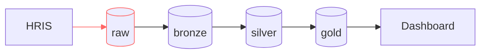

# Solución — GOV-04

## 1. Auditoría
```python
tables = spark.sql("""
SELECT t.table_catalog, t.table_schema, t.table_name,
       t.table_owner, t.comment,
       t.last_altered
FROM system.information_schema.tables t
WHERE t.table_catalog NOT IN ('system', 'samples')
""").createOrReplaceTempView("t")

health = spark.sql("""
SELECT t.*,
  CASE WHEN table_owner IS NOT NULL THEN 1 ELSE 0 END AS has_owner,
  CASE WHEN comment IS NOT NULL THEN 1 ELSE 0 END AS has_comment,
  datediff(current_date(), last_altered) AS dias_sin_cambio
FROM t""")

# % columnas documentadas por tabla
cols = spark.sql("""
SELECT table_name,
  ROUND(100.0*SUM(comment IS NOT NULL)/COUNT(*),1) AS pct_cols_doc
FROM system.information_schema.columns
WHERE table_catalog NOT IN ('system','samples')
GROUP BY table_name""")

(health.join(cols, "table_name", "left")
 .write.format("delta").mode("overwrite")
 .saveAsTable("zenviro.governance.health_check"))
```

## 2. Process map (Mermaid)

Puntos sin control típicos: ingesta sin validación, sin owner en silver, dashboards sin certificación.

## 4. Métricas (ejemplo)
| Métrica | Línea base | Objetivo 3M |
|---|---|---|
| % tablas con owner | 40% | 100% |
| % columnas documentadas | 15% | 80% |
| Incidencias calidad/mes | 6 | <2 |
| Tiempo en encontrar un dato | 2 días | <1 hora |

## 5. Roadmap
Prioridad = impacto/esfuerzo. Top 3 típicas: (1) owners+tags en gold (impacto 5/esfuerzo 1), (2) expectations en ingesta (5/2), (3) diccionario silver (4/3).

## Puntos clave
- Sin auditoría medible no hay roadmap: mide primero.
- Outcome metrics ≠ vanity metrics ("nº de reuniones del consejo" no mide nada).
- Quick wins primero: alto impacto/bajo esfuerzo construyen credibilidad del programa.
